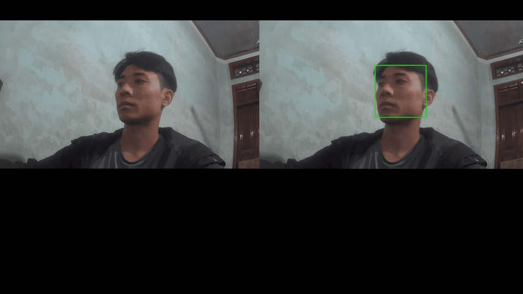

# Smart Edge Camera: Dual-Stream H.264 RTSP & RetinaFace NPU Vision Firmware

[](https://wiki.luckfox.com)
[](https://www.rock-chips.com)
[]()
[-brightgreen.svg)]()

A high-performance embedded Linux vision firmware developed for the **Luckfox Pico Pro** (Rockchip RV1106G3 / RV1103 SoC, Cortex-A7 @ 1.2GHz, 128MB RAM, 0.5 TOPS NPU). The firmware implements an end-to-end **Zero-Copy DMA** architecture delivering simultaneous **1080p pristine evidence streaming**, **640x360 real-time preview with AI bounding box overlays**, and hardware-accelerated **RetinaFace 640x640 face detection** running stably at **30 FPS**.

---

## 🎥 Live Dual-Stream & AI Inference Demonstration

<p align="center">
  
</p>

*Trình chiếu đồng thời 2 luồng RTSP độc lập từ Luckfox Pico Pro (RV1106) tại 30 FPS:*
- **Cửa sổ 1 (Trái - `rtsp://<BOARD_IP>:554/live/main`)**: Luồng 1080p H.264 nguyên bản (Pristine Video), không chèn OSD, phục vụ trích xuất bằng chứng an ninh.
- **Cửa sổ 2 (Phải - `rtsp://<BOARD_IP>:554/live/sub`)**: Luồng 640x360 H.264 preview thời gian thực, có khung màu xanh (Bounding Box) bám theo khuôn mặt do NPU RetinaFace phát hiện và RGA burn-in trực tiếp trên phần cứng.

---

## 1. System Architecture & Live Pipeline

```
[SC3336 3MP Sensor] -> MIPI-CSI2 (2-lane Raw Bayer)
         |
         v
[Rockchip ISP3A] ----> Auto-Exposure / AWB / Hardware Denoise
         |
         v (Zero-Copy 4x 1080p NV12 Ring Buffers via CMA DMA-BUF)
[V4L2 /dev/video11]
         |
         +-------------------------------------------------------+
         | (1080p NV12 DMA-BUF)                                  | (1080p NV12 DMA-BUF)
         v                                                       v
[Rockchip MPP VEPU Chan 0]                              [Rockchip RGA Blit #1]
- 1080p H.264 CBR @ 2.5 Mbps                            - Hardware Downscale -> 640x360 NV12
- Evidentiary Video (No OSD)                                     |
         |                                                       +-------------------------------+
         |                                                       |                               |
         | (1080p H.264 NALs)                                    v (640x360 NV12)                v (640x360 NV12)
         |                                             [Rockchip RGA Blit #2]         [Rockchip RGA OSD Burn-In]
         |                                             - Letterbox ROI (Pad 140px)    - Draw Green Bounding Box
         |                                             - 640x640 BGR888 (1:1 Ratio)   - Even-Aligned Coordinates
         |                                                       |                               |
         |                                                       v (Zero-Copy DMA)               v (640x360 NV12 + OSD)
         |                                             [Rockchip NPU (RKNN)]          [Rockchip MPP VEPU Chan 1]
         |                                             - RetinaFace 640x640           - 640x360 H.264 @ 800 Kbps
         |                                             - Latency: 29.8 ms (30 FPS)    - Real-Time Preview
         |                                             - 16800 Priors + EMA Tracker              |
         |                                                       |                               |
         |                                                       +-------(Bounding Boxes)--------+
         |                                                                                       |
         v                                                                                       v
+---------------------------------------------------------------------------------------------------------+
|                                    Embedded RTSP Server (Port 554)                                      |
|                                     RFC 2326 & RFC 6184 (UDP / TCP)                                     |
|                                                                                                         |
|       rtsp://<IP>:554/live/main (1080p Clean)           rtsp://<IP>:554/live/sub (360p + AI OSD)        |
+---------------------------------------------------------------------------------------------------------+
```

---

## 2. Key Engineering Highlights

### 1. True End-to-End Zero-Copy DMA Architecture
- **No CPU Memory Copies**: Physical frame memory is allocated from Linux CMA (`/dev/rk_dma_heap/rk-dma-heap-cma`) and passed directly between V4L2, RGA, NPU, and MPP using **DMA-BUF file descriptors** (`dma_fd`).
- **Memory Envelope**: Operates smoothly within Luckfox Pico Pro's **128MB RAM** (66MB CMA reserved pool + 62MB Linux OS memory), maintaining **85% idle CPU capacity** during full dual-stream encoding and 30 FPS AI tracking.

### 2. Dual-Stream H.264 Hardware Encoding (Rockchip MPP)
- **Main Stream (`/live/main`)**: 1920x1080 @ 30 FPS, H.264 Baseline, 2.5 Mbps CBR, GOP=60. Clean evidentiary record.
- **Sub Stream (`/live/sub`)**: 640x360 @ 30 FPS, H.264 Baseline, 800 Kbps CBR, GOP=60. Real-time preview with AI bounding boxes burned directly into hardware NV12 frames by RGA before encoding.

### 3. Aspect-Preserving RGA Letterbox ROI (1:1 Aspect Ratio)
- **Root Cause of Distortion**: Sub-stream is 16:9 (`640x360`), while RetinaFace requires 1:1 (`640x640`). Directly stretching 360p to 640p elongates faces vertically by **1.78×** (nearly 80% taller), degrading detection confidence and warping bounding boxes.
- **Hardware Solution**: RGA `improcess()` scales `640x360` with a 140-pixel black border on top and bottom (`pad_y = 140`), presenting a 100% natural, undistorted image to the NPU.
- **Inverse Coordinate Mapping**: Box coordinates from the NPU are mapped back accurately to sub-stream pixels:
  - `y_sub = y_640 - 140`
  - `x_sub = x_640`

### 4. Robust RetinaFace Postprocessing, NMS & EMA Tracking
- **Background Logit Suppression**: Enforces `face_score >= 0.55` **and** `face_score > bg_score` to eliminate false positive background clutter.
- **EMA Temporal Smoothing**: Applies Exponential Moving Average (EMA, `α = 0.65`) across frames with `IoU > 0.30`, eliminating boundary jitter and quantization noise.
- **Persistence Tracking**: Retains tracked faces for up to **3 frames (~100 ms)** during transient occlusion or fast head turns, completely preventing visible box flickering.
- **NV12 Alignment**: All bounding box coordinates and sizes are aligned to even integers (`bx &= ~1; by &= ~1; bw &= ~1; bh &= ~1;`) to satisfy NV12 2x2 chroma subsampling constraints.

### 5. Embedded Self-Contained RTSP Server
- Built directly in C++17 with **zero external dependencies** (no live555, no FFmpeg).
- Implements RFC 2326 (RTSP) and RFC 6184 (H.264 RTP Packetization with FU-A fragmentation).
- Supports both **UDP** (lowest latency) and **TCP Interleaved** streaming modes.

---

## 3. Directory Layout

```text
smart-edge-camera/
├── cmake/                      # Toolchain definitions for RV1106/RV1103 uClibc-ng
│   └── toolchain-arm-rockchip830-uclibcgnueabihf.cmake
├── docs/                       # Technical specifications, architecture docs & diagrams
│   ├── ARCHITECTURE.md         # Comprehensive systems architecture specification
│   ├── diagrams/
│   │   ├── hardware_pipeline.svg      # Vector SVG of dual-stream pipeline
│   │   ├── letterbox_geometry.svg     # Vector SVG of letterbox math & ROI
│   │   ├── pipeline_architecture.puml # PlantUML sequence diagram
│   │   └── generate_diagrams.py       # Diagram generator script
│   └── v4l2_info.txt
├── include/                    # Public C++17 headers
│   ├── camera/v4l2_camera.hpp         # V4L2 zero-copy ingestion
│   ├── encoder/mpp_encoder.hpp        # Rockchip MPP dual H.264 encoder
│   ├── npu/                           # RKNN NPU runtime & API
│   ├── pipeline/                      # Coordinator, BoundedQueue, RetinaFace priors
│   ├── rga/rga_converter.hpp          # RGA 2D blitter, letterbox & OSD drawer
│   ├── rtsp/rtsp_server.hpp           # Embedded RTSP/RTP streaming server
│   └── utils/dma_allocator.hpp        # Linux CMA DMA-BUF heap allocator
├── models/
│   └── retinaface.rknn         # Official quantized INT8 RetinaFace model (651 KB)
├── scripts/
│   ├── build.sh                # Automated cross-compilation script
│   └── S99smart_edge_camera    # SysV init auto-start daemon script
├── src/                        # Modular C++17 implementations
│   ├── camera/v4l2_camera.cpp
│   ├── encoder/mpp_encoder.cpp
│   ├── npu/rknn_engine.cpp
│   ├── pipeline/camera_pipeline.cpp
│   ├── rga/rga_converter.cpp
│   ├── rtsp/rtsp_server.cpp
│   ├── utils/dma_allocator.cpp
│   └── main.cpp
├── tests/                      # Automated unit and hardware integration tests
│   ├── test_framework.hpp             # Zero-dependency C++17 micro test framework
│   ├── test_bounded_queue.cpp         # Queue FIFO & drop-oldest tests
│   ├── test_dma_allocator.cpp         # CMA allocation & mmap tests
│   ├── test_rga_converter.cpp         # RGA blit, letterbox & OSD tests
│   ├── test_v4l2_camera.cpp           # Camera capture & ring buffer tests
│   ├── test_mpp_encoder.cpp           # Dual MPP H.264 encode tests
│   ├── test_rknn_engine.cpp           # NPU model loading & latency tests
│   ├── test_rtsp_server.cpp           # RTSP handshake & RTP push tests
│   ├── test_pipeline_logic.cpp        # Anchors, NMS, EMA & letterbox math tests
│   └── run_all_tests.sh               # Target board automated test runner
├── CMakeLists.txt              # Top-level CMake build configuration
├── LICENSE
└── README.md
```

---

## 4. Hardware Specifications & Live Performance

Tested live on **Luckfox Pico Pro** (Rockchip RV1106G3 @ 1.2GHz, SC3336 3MP sensor, Linux 5.10):

| Component | Resolution / Format | Latency (Δt) | Throughput | Resource Usage |
| :--- | :--- | :---: | :---: | :---: |
| **V4L2 Ingestion** | 1920x1080 NV12 | Continuous | **30.00 FPS** | 0% CPU (ISP3A) |
| **MPP Main Encode** | 1080p H.264 CBR (2.5 Mbps) | ~4.2 ms | **30.00 FPS** | 0% CPU (VEPU) |
| **RGA Sub Downscale** | 1080p -> 640x360 NV12 | ~1.8 ms | **30.00 FPS** | 0% CPU (RGA) |
| **RGA Letterbox Blit** | 640x360 -> 640x640 BGR888 | ~1.9 ms | **30.00 FPS** | 0% CPU (RGA) |
| **RetinaFace Inference** | 640x640 INT8 (16800 Priors) | **29.8 ms** | **30.00 FPS** | 0% CPU (NPU) |
| **RGA OSD Drawing** | 640x360 NV12 Green Rect | ~0.4 ms | **30.00 FPS** | 0% CPU (RGA) |
| **MPP Sub Encode** | 640x360 H.264 CBR (800 Kbps) | ~2.1 ms | **30.00 FPS** | 0% CPU (VEPU) |
| **RTSP / RTP Server** | Port 554 (TCP/UDP) | Microseconds | **30.00 FPS** | ~5% CPU |
| **Overall System** | **Dual 1080p/360p + AI OSD** | **Real-Time** | **30.00 FPS (0 drops)** | **85% IDLE CPU** |

---

## 5. Build, Cross-Compilation & Deployment

### Prerequisites
- **Host OS**: Linux Ubuntu 20.04 / 22.04 LTS (x86_64)
- **Cross Toolchain**: `arm-rockchip830-linux-uclibcgnueabihf` (included with Luckfox Pico SDK)
- **CMake**: Version >= 3.16

### Build Steps
```bash
# Clone the repository
git clone https://github.com/QuocHoang-git/smart-edge-camera.git
cd smart-edge-camera

# Compile application and all test binaries
./scripts/build.sh
```

The build produces:
- Main binary: `build/smart_edge_camera`
- Test executables: `build/test_*` (8 test suites)

### Deploy to Luckfox Board
```bash
# Stop running service
ssh root@192.168.8.2 "/etc/init.d/S99smart_edge_camera stop"

# Copy binary and model
scp build/smart_edge_camera root@192.168.8.2:/usr/bin/smart_edge_camera
scp models/retinaface.rknn root@192.168.8.2:/userdata/retinaface.rknn

# Start background service
ssh root@192.168.8.2 "/etc/init.d/S99smart_edge_camera start"
```

---

## 6. Live Streaming & Client Verification

Open the RTSP streams in VLC, FFplay, or an NVR:

- **Main Stream (Clean 1080p @ 30 FPS)**:
  ```bash
  vlc rtsp://192.168.169.128:554/live/main
  ```
- **Sub Stream (AI Bounding Box 640x360 @ 30 FPS)**:
  ```bash
  vlc rtsp://192.168.169.128:554/live/sub
  ```

> [!TIP]
> **UDP Streaming**: By default, VLC opens RTSP over UDP. To stream over TCP in lossy network environments, append `--rtsp-tcp` in VLC or `-rtsp_transport tcp` in FFplay.

---

## 7. Automated Test Suite

Run the built-in test suite directly on the Luckfox hardware:
```bash
# On the Luckfox Pico board
/userdata/tests/run_all_tests.sh
```

### Test Coverage Matrix (25/25 Passing)
- **`test_bounded_queue`**: FIFO verification, drop-oldest policy, timeout handling, thread safety.
- **`test_pipeline_logic`**: 16,800 anchor ranges, letterbox unpadding, SSD variance regression, NMS deduplication, EMA smoothing & persistence tracking.
- **`test_rtsp_server`**: Port binding, RFC 2326 OPTIONS/DESCRIBE handshakes, SDP verification, RTP frame pushing.
- **`test_dma_allocator`**: Linux CMA physical contiguous allocation, mmap virtual access, move semantics.
- **`test_rga_converter`**: Hardware RGA context init, 1080p->360p downscaling, letterbox ROI blit, even-aligned OSD box drawing.
- **`test_mpp_encoder`**: Dual VEPU channel init, zero-copy DMA bitstream encoding, H.264 IDR/SPS/PPS generation.
- **`test_rknn_engine`**: RetinaFace RKNN loading, tensor IO topology, DMA buffer binding, inference latency check.
- **`test_v4l2_camera`**: `/dev/video11` device init, 4x 1080p ring buffer negotiation, frame dequeue/enqueue streaming.

---

## 8. Service Management & Auto-Start

The firmware is managed as a SysV init daemon (`/etc/init.d/S99smart_edge_camera`), ensuring automatic start at boot with safe synchronization for `rkaiq_3A_server` convergence:

```bash
# Check service status
/etc/init.d/S99smart_edge_camera status

# Stop service
/etc/init.d/S99smart_edge_camera stop

# Start service
/etc/init.d/S99smart_edge_camera start

# Restart service
/etc/init.d/S99smart_edge_camera restart

# View real-time service logs
tail -f /tmp/smart_edge_camera.log
```

---

## 9. License

This project is licensed under the MIT License. See [LICENSE](LICENSE) for details.
